# Fase II: Diseño — texto para el Capítulo IV

Texto listo para pegar en el `.docx` del Capítulo IV, a continuación de la
Fase I (después del apartado 1.1.1.6 que propone
[`../correcciones-capitulo-4.md`](../correcciones-capitulo-4.md)). Las imágenes
de los gráficos están en [`diagramas/png/`](diagramas/png/) y los prototipos
en [`prototipos/`](prototipos/). Las fuentes editables de cada diagrama están
en [`diagramas/`](diagramas/) y el diseño físico completo, en
[`esquema-operacion.sql`](esquema-operacion.sql).

Numeración: continúa la del capítulo corregido. Los cuadros siguen desde el
37 y los gráficos desde el 22 (los Gráficos 1 a 21 son los de la encuesta).
Se usa «Gráfico» y no «Figura» para mantener la convención del capítulo.

---

**1.1.2. FASE II: DISEÑO (BECK, 2004)**

En cumplimiento del tercer objetivo específico de la investigación, que
consiste en diseñar lógica y físicamente la aplicación móvil basada en SIG
para el manejo operativo del servicio de transporte en una comunidad
universitaria, se desarrolló la Fase II de la metodología. En la Programación
Extrema, el diseño se mantiene tan simple como lo permitan las historias de
usuario vigentes y se expresa mediante artefactos ligeros que el equipo
comparte: diagramas que comunican la estructura y el comportamiento del
sistema, tarjetas CRC, una metáfora que unifica el vocabulario y prototipos
que se validan con los usuarios antes de codificar.

Todos los artefactos de esta fase se derivan del catálogo de dieciséis (16)
historias de usuario y de los requerimientos presentados en los Cuadros 16 y
17, de modo que cada decisión de diseño puede rastrearse hasta una necesidad
expresada por los informantes clave. A continuación, se presentan los
resultados de las cinco actividades que conforman la fase.

---

**1.1.2.1. ELABORACIÓN DE DIAGRAMAS UML Y DE FLUJO**

Para representar los procesos de la aplicación se elaboraron diagramas del
Lenguaje Unificado de Modelado (UML) de casos de uso, clases, estados y
secuencia, complementados con diagramas de flujo de los dos procesos
centrales del sistema y un diagrama de la arquitectura de despliegue.

**Diagramas de casos de uso**

Los diagramas de casos de uso muestran las funciones que la aplicación ofrece
a cada actor. Se elaboró un diagrama por actor para facilitar su lectura, y
cada caso de uso indica la historia de usuario que lo especifica.

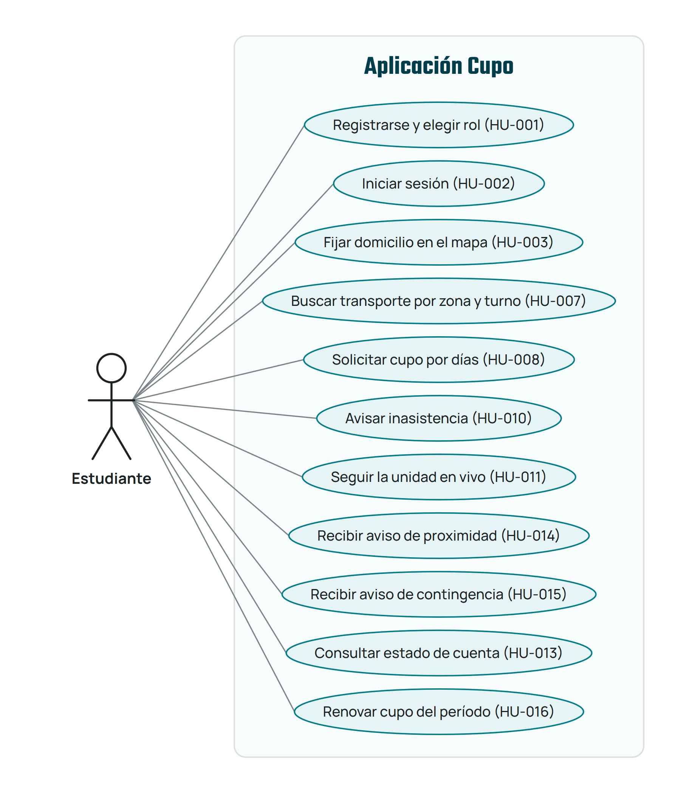

**Gráfico 22.** Diagrama de casos de uso del estudiante.
Fuente: Andrade, Espina y Ramírez (2026)

El Gráfico 22 reúne las once (11) funciones disponibles para el estudiante.
Además del acceso, se agrupan en tres momentos de su relación con el
servicio: encontrar transporte (fijar el domicilio, buscar y solicitar un
cupo), viajar (avisar inasistencia, seguir la unidad y recibir los avisos de
proximidad y de contingencia) y mantener el servicio en el tiempo (consultar
su estado de cuenta y renovar el cupo).

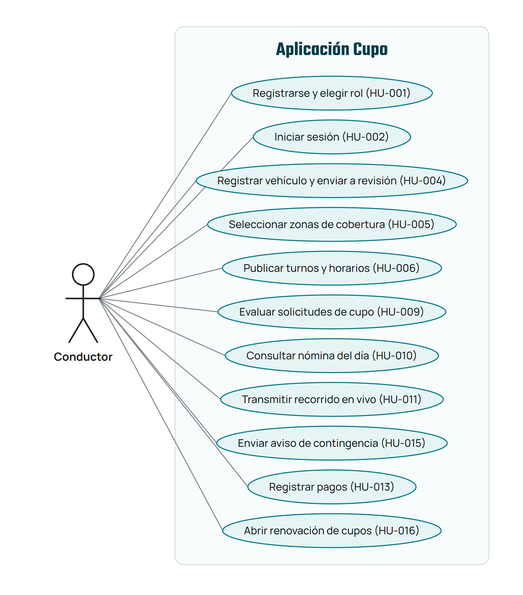

**Gráfico 23.** Diagrama de casos de uso del conductor.
Fuente: Andrade, Espina y Ramírez (2026)

El conductor, como se observa en el Gráfico 23, es el actor con más
responsabilidades operativas: define su oferta (vehículo, zonas y turnos),
administra la demanda (evalúa solicitudes, consulta la nómina y abre la
renovación) y opera el servicio diario (transmite el recorrido, envía avisos
de contingencia y registra los pagos). Estas funciones sustituyen las
herramientas que hoy emplea, descritas en los Cuadros 10 y 13: grupos de
WhatsApp, llamadas y una libreta.

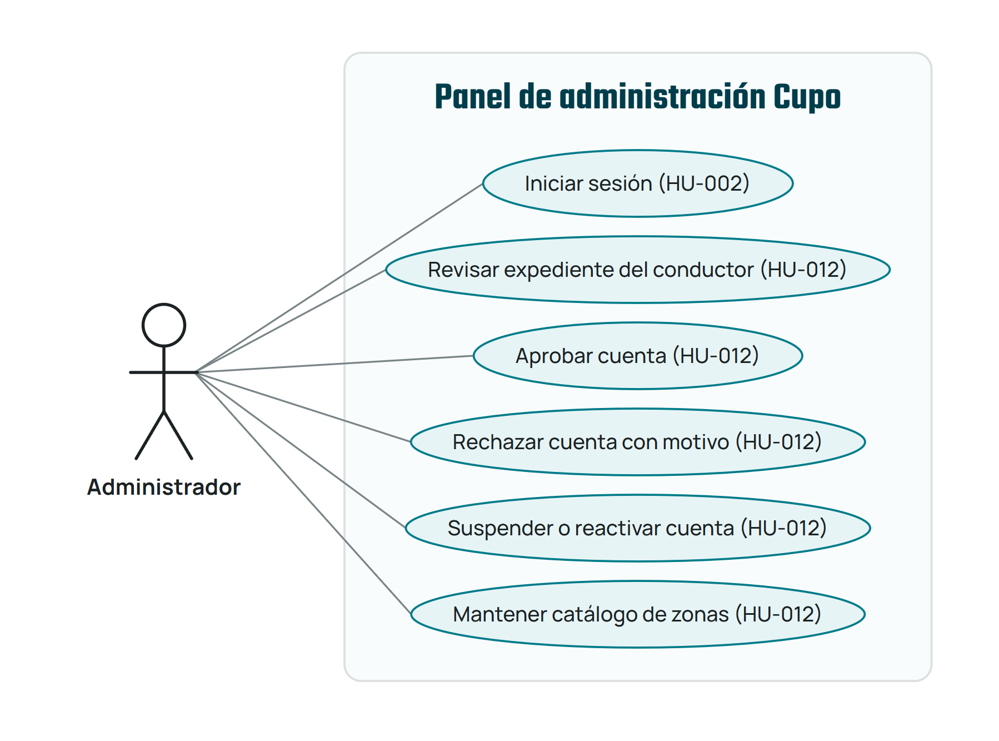

**Gráfico 24.** Diagrama de casos de uso del administrador.
Fuente: Andrade, Espina y Ramírez (2026)

El administrador opera desde un panel web (Gráfico 24) y se encarga de la
gobernanza de la plataforma: verifica el expediente de cada conductor antes
de habilitarlo y mantiene el catálogo de zonas geográficas sobre el que se
apoya el emparejamiento entre estudiantes y transportistas.

**Diagrama de clases**

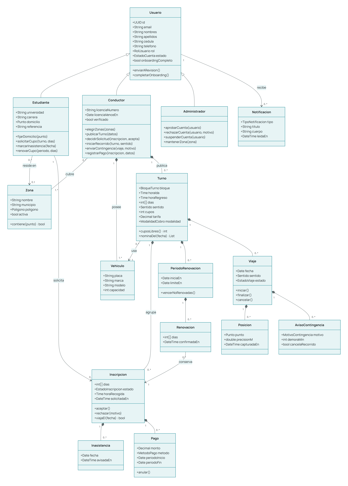

**Gráfico 25.** Diagrama de clases del dominio.
Fuente: Andrade, Espina y Ramírez (2026)

El Gráfico 25 presenta las dieciséis (16) clases del dominio y sus
relaciones. La clase **Usuario** se especializa en Estudiante, Conductor y
Administrador, que comparten los datos de identificación y el estado de la
cuenta. El núcleo de la operación es la clase **Turno**, que representa la
oferta de un conductor en un bloque horario con un vehículo, unos días, un
sentido y un número de cupos. Una **Inscripción** vincula a un estudiante con
un turno; mientras está aceptada ocupa un cupo, y de ella dependen las
inasistencias, los pagos y las renovaciones. Cada recorrido diario de un
turno es un **Viaje**, compuesto por las posiciones transmitidas y, si las
hubo, los avisos de contingencia. Finalmente, la clase **Zona** relaciona
geográficamente a ambos actores: el estudiante reside en una zona y el
conductor cubre una o varias.

**Diagramas de estados**

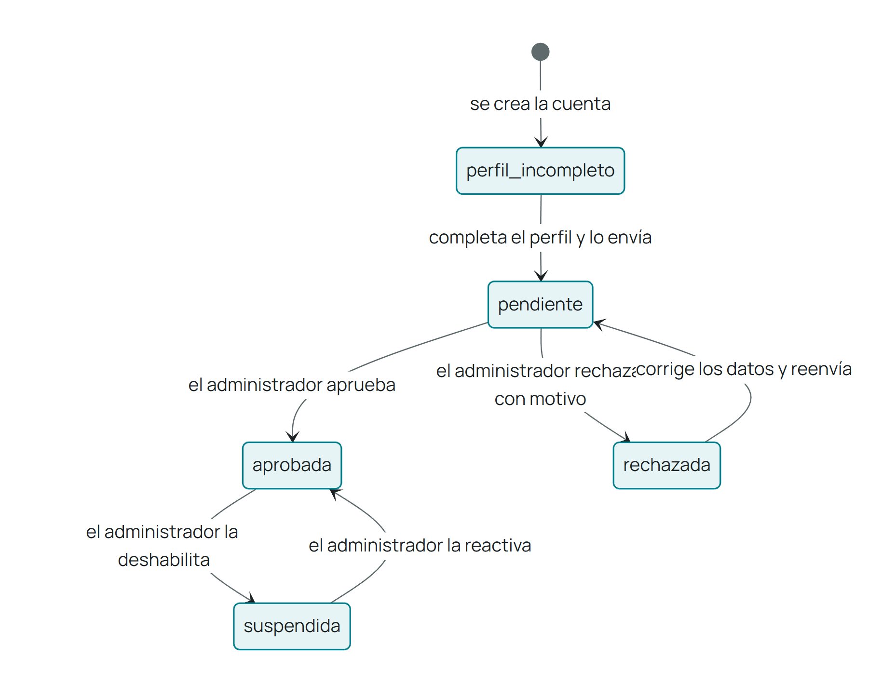

**Gráfico 26.** Diagrama de estados de la cuenta de usuario.
Fuente: Andrade, Espina y Ramírez (2026)

El Gráfico 26 describe el ciclo de vida de una cuenta. Toda cuenta nace con
el perfil incompleto; al completarlo, pasa a revisión (pendiente) y el
administrador la aprueba o la rechaza con un motivo. Una cuenta rechazada
puede corregirse y reenviarse, y una aprobada puede suspenderse y
reactivarse. Este estado gobierna el enrutamiento descrito en HU-002: cada
estado conduce al usuario a una pantalla distinta.

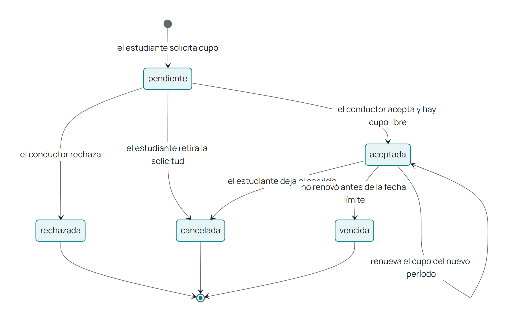

**Gráfico 27.** Diagrama de estados de la inscripción a un turno.
Fuente: Andrade, Espina y Ramírez (2026)

La inscripción (Gráfico 27) formaliza el acuerdo que hoy es verbal. Nace
pendiente cuando el estudiante solicita el cupo (HU-008), se acepta o rechaza
por decisión del conductor (HU-009) y, una vez aceptada, se mantiene mientras
el estudiante renueve en cada período (HU-016). Si no renueva antes de la
fecha límite, vence y el cupo se libera automáticamente, lo que resuelve la
incertidumbre entre semestres reportada en el Cuadro 7 y en la Tabla 15.

**Diagramas de secuencia**

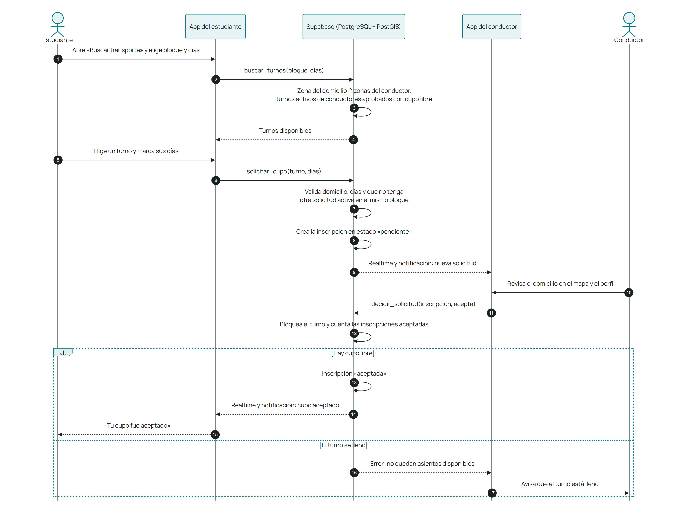

**Gráfico 28.** Diagrama de secuencia de la solicitud y aceptación de un cupo.
Fuente: Andrade, Espina y Ramírez (2026)

El Gráfico 28 detalla la interacción entre el estudiante, el conductor y el
servidor al contratar el servicio. Las validaciones de negocio (domicilio
fijado, días válidos, una sola solicitud por bloque horario y existencia de
cupo) se ejecutan en la base de datos y no en el teléfono, lo que impide
eludirlas desde un cliente modificado. Al aceptar, el servidor bloquea el
registro del turno mientras cuenta las inscripciones aceptadas; así, si dos
estudiantes compiten por el último asiento, solo uno lo obtiene (RNF-06).

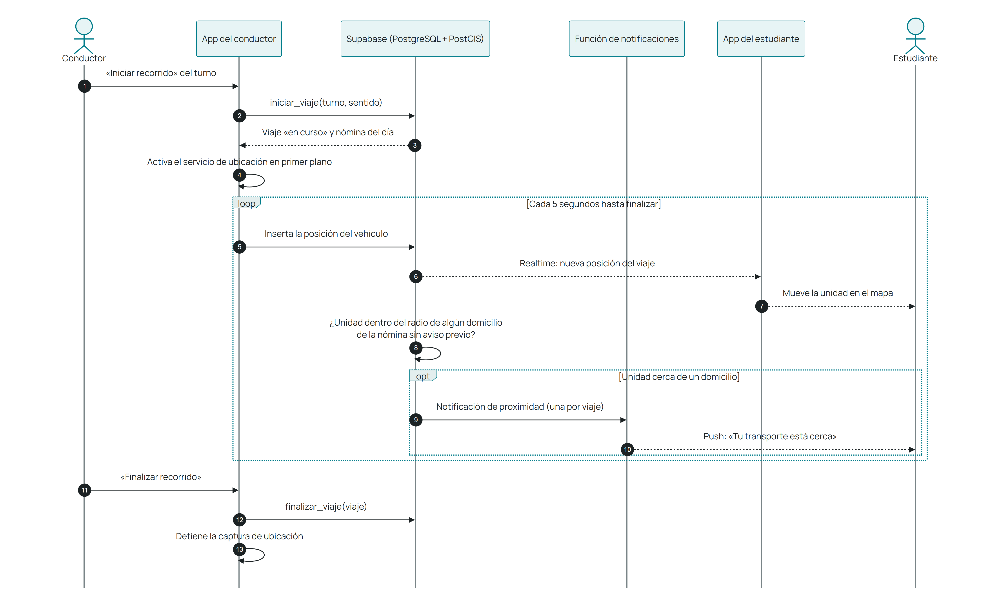

**Gráfico 29.** Diagrama de secuencia del recorrido en vivo y del aviso de proximidad.
Fuente: Andrade, Espina y Ramírez (2026)

En el Gráfico 29 se observa el funcionamiento del núcleo SIG en tiempo real.
Al iniciar el recorrido, la aplicación del conductor activa un servicio de
ubicación en primer plano, que Android exige para seguir obteniendo la
posición con la aplicación minimizada, y envía una posición cada cinco
segundos. El envío se hace mediante una petición HTTP que inserta la posición
en la base de datos, y no por el canal de tiempo real, porque la biblioteca
cliente de Supabase cierra ese canal cuando la aplicación pasa a segundo
plano. Cada posición se difunde a los estudiantes del turno y, además, el
servidor calcula si la unidad entró en el radio de proximidad de algún
domicilio de la nómina; en ese caso, envía una única notificación al
estudiante (HU-014).

**Diagramas de flujo**

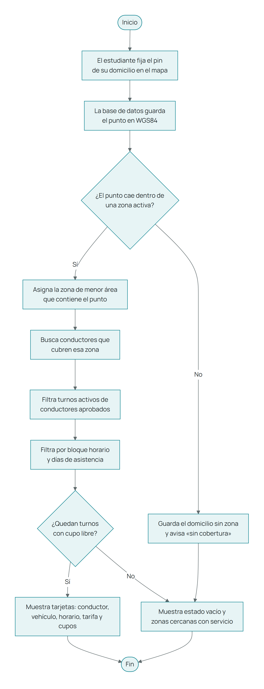

**Gráfico 30.** Diagrama de flujo de la detección de zona y la búsqueda de transporte.
Fuente: Andrade, Espina y Ramírez (2026)

El Gráfico 30 representa el algoritmo central de emparejamiento geográfico.
El domicilio del estudiante se almacena como un punto, y la base de datos
determina, mediante una operación de punto en polígono, a qué zona activa
pertenece. Si varias zonas lo contienen, se elige la de menor área, por ser
la más específica. La búsqueda cruza esa zona con las zonas de cobertura de
cada conductor y filtra los turnos por bloque horario, días y cupos libres.
Si el domicilio queda fuera de toda zona, el sistema lo registra igualmente e
informa al estudiante que su sector aún no tiene cobertura.

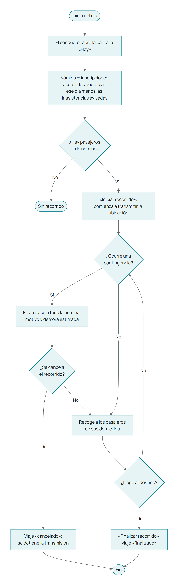

**Gráfico 31.** Diagrama de flujo de la operación diaria del conductor.
Fuente: Andrade, Espina y Ramírez (2026)

El Gráfico 31 describe la jornada del conductor con la aplicación. La nómina
del día se calcula automáticamente con las inscripciones aceptadas que
asisten ese día de la semana, descontando las inasistencias avisadas (HU-010).
Durante el recorrido, una contingencia puede comunicarse a toda la nómina en
un solo paso (HU-015), ya sea para informar una demora o para cancelar el
viaje.

**Arquitectura de la solución**

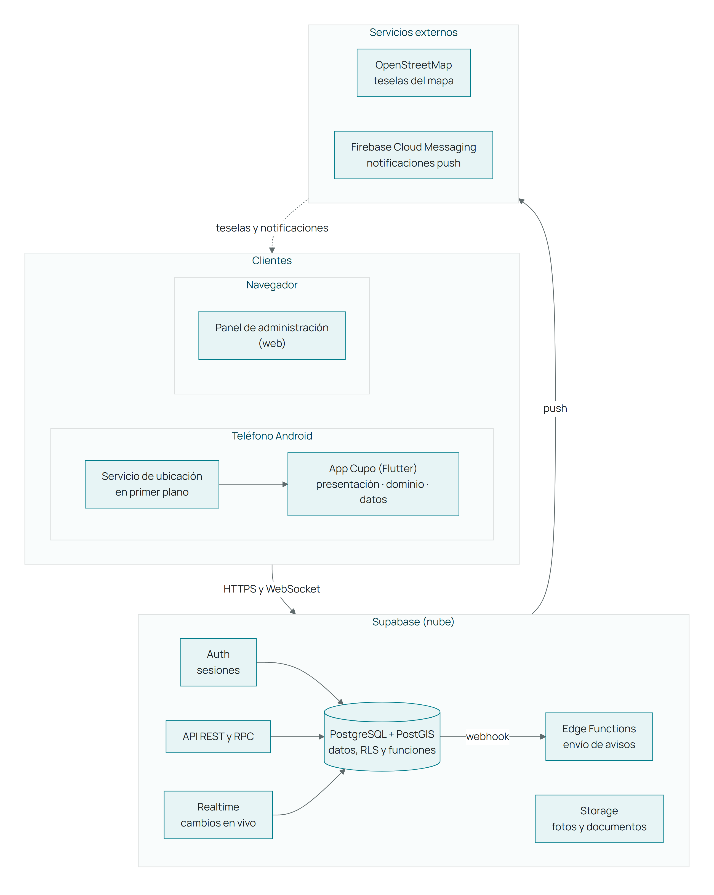

**Gráfico 32.** Diagrama de arquitectura de la aplicación.
Fuente: Andrade, Espina y Ramírez (2026)

Como se observa en el Gráfico 32, la solución se compone de dos clientes, la
aplicación móvil en Flutter para estudiantes y conductores y un panel web
para el administrador, que se comunican con la plataforma Supabase. Esta
provee la autenticación, una interfaz de programación sobre la base de datos
PostgreSQL con la extensión espacial PostGIS, la difusión de cambios en
tiempo real, el almacenamiento de fotografías y documentos, y funciones en la
nube para enviar notificaciones a través de Firebase Cloud Messaging. Los
mapas se dibujan con teselas de OpenStreetMap. Dentro de la aplicación, el
código se organiza por funcionalidad y, en cada una, en capas de
presentación, dominio y datos.

---

**1.1.2.2. CONSTRUCCIÓN DE TARJETAS CRC**

Las tarjetas CRC (Clase, Responsabilidad y Colaboración) son la herramienta
de diseño orientado a objetos propia de la Programación Extrema. Cada tarjeta
nombra una clase, enumera lo que sabe y lo que hace (sus responsabilidades) e
indica con qué otras clases necesita interactuar para cumplirlas (sus
colaboradores). Se elaboraron tarjetas para las doce (12) clases principales
del Gráfico 25; las clases restantes (Inasistencia, PeriodoRenovacion,
Renovacion y AvisoContingencia) son registros sin comportamiento propio y
sus responsabilidades quedan cubiertas por las tarjetas de Inscripción,
Turno y Viaje.

> Nota de redacción: si el Cap. III atribuye las tarjetas CRC a Beck (2004),
> mantengan esa cita aquí. Si quieren citar el origen de la técnica, es
> Beck y Cunningham (1989); agréguenla solo si la incorporan a las referencias.

**Cuadro 37**
**Tarjeta CRC: Usuario**

| Responsabilidades | Colaboradores |
| --- | --- |
| Conocer sus datos de identificación: nombres, cédula, teléfono y correo. | — |
| Conocer su rol y el estado de su cuenta. | — |
| Enviar su perfil a revisión. | Administrador |
| Completar la configuración inicial propia de su rol. | Estudiante, Conductor |
| Recibir y marcar como leídas sus notificaciones. | Notificación |

Fuente: Andrade, Espina y Ramírez (2026)

**Cuadro 38**
**Tarjeta CRC: Estudiante**

| Responsabilidades | Colaboradores |
| --- | --- |
| Conocer su domicilio, su referencia y su zona. | Zona |
| Fijar o corregir el domicilio en el mapa. | Zona |
| Buscar turnos que cubran su zona y su horario. | Turno, Zona |
| Solicitar un cupo indicando sus días de asistencia. | Turno, Inscripción |
| Avisar una inasistencia. | Inscripción |
| Renovar su cupo en cada período. | Turno, Inscripción |
| Consultar su estado de cuenta. | Pago |

Fuente: Andrade, Espina y Ramírez (2026)

**Cuadro 39**
**Tarjeta CRC: Conductor**

| Responsabilidades | Colaboradores |
| --- | --- |
| Conocer su licencia, sus vencimientos y si está verificado. | — |
| Registrar sus vehículos. | Vehículo |
| Elegir las zonas que cubre. | Zona |
| Publicar y modificar sus turnos. | Turno, Vehículo |
| Aceptar o rechazar solicitudes de cupo. | Inscripción, Turno |
| Iniciar, transmitir y finalizar recorridos. | Viaje, Posición |
| Enviar avisos de contingencia. | Viaje, Notificación |
| Registrar y anular pagos. | Pago, Inscripción |

Fuente: Andrade, Espina y Ramírez (2026)

**Cuadro 40**
**Tarjeta CRC: Administrador**

| Responsabilidades | Colaboradores |
| --- | --- |
| Revisar el expediente de los conductores. | Conductor, Vehículo |
| Aprobar, rechazar con motivo, suspender o reactivar cuentas. | Usuario, Notificación |
| Crear, editar, activar o desactivar zonas. | Zona |

Fuente: Andrade, Espina y Ramírez (2026)

**Cuadro 41**
**Tarjeta CRC: Zona**

| Responsabilidades | Colaboradores |
| --- | --- |
| Conocer su nombre, su municipio y su polígono. | — |
| Determinar si contiene un punto geográfico. | Estudiante |
| Saber si está activa para nuevas asignaciones. | — |
| Conocer qué conductores la cubren. | Conductor |

Fuente: Andrade, Espina y Ramírez (2026)

**Cuadro 42**
**Tarjeta CRC: Vehículo**

| Responsabilidades | Colaboradores |
| --- | --- |
| Conocer su placa, marca, modelo, color y fotografía. | — |
| Conocer su capacidad de asientos. | — |
| Limitar los cupos de los turnos que lo usan. | Turno |

Fuente: Andrade, Espina y Ramírez (2026)

**Cuadro 43**
**Tarjeta CRC: Turno**

| Responsabilidades | Colaboradores |
| --- | --- |
| Conocer su bloque, horas, días, sentido, tarifa y modalidad de cobro. | — |
| Calcular sus cupos libres. | Inscripción |
| Calcular la nómina de una fecha. | Inscripción |
| Abrir un período de renovación y vencer los cupos no renovados. | Inscripción |
| Originar los viajes de cada día. | Viaje |

Fuente: Andrade, Espina y Ramírez (2026)

**Cuadro 44**
**Tarjeta CRC: Inscripción**

| Responsabilidades | Colaboradores |
| --- | --- |
| Conocer el estudiante, el turno, los días y su estado. | Estudiante, Turno |
| Conocer la hora de recogida acordada con el conductor. | Conductor |
| Pasar de pendiente a aceptada o rechazada. | Turno, Notificación |
| Indicar si el estudiante viaja en una fecha. | — |
| Registrar las inasistencias avisadas. | — |
| Acumular los pagos de cada período. | Pago |
| Renovarse o vencer al cerrar un período. | Turno |

Fuente: Andrade, Espina y Ramírez (2026)

**Cuadro 45**
**Tarjeta CRC: Viaje**

| Responsabilidades | Colaboradores |
| --- | --- |
| Conocer su turno, fecha, sentido y estado. | Turno |
| Iniciarse, finalizarse o cancelarse. | Conductor |
| Recibir las posiciones del vehículo. | Posición |
| Registrar y difundir los avisos de contingencia. | Notificación |

Fuente: Andrade, Espina y Ramírez (2026)

**Cuadro 46**
**Tarjeta CRC: Posición**

| Responsabilidades | Colaboradores |
| --- | --- |
| Conocer su punto, su precisión y la hora de captura. | Viaje |
| Detectar los domicilios de la nómina que quedan dentro del radio de proximidad. | Estudiante, Notificación |

Fuente: Andrade, Espina y Ramírez (2026)

**Cuadro 47**
**Tarjeta CRC: Pago**

| Responsabilidades | Colaboradores |
| --- | --- |
| Conocer monto, método y período cubierto. | Inscripción |
| Evitar dos pagos vigentes para el mismo período. | Inscripción |
| Anularse sin borrar su historial. | Conductor |

Fuente: Andrade, Espina y Ramírez (2026)

**Cuadro 48**
**Tarjeta CRC: Notificación**

| Responsabilidades | Colaboradores |
| --- | --- |
| Conocer su destinatario, tipo, título y cuerpo. | Usuario |
| Entregarse por notificación push al teléfono del destinatario. | Usuario |
| Registrar cuándo fue leída. | Usuario |

Fuente: Andrade, Espina y Ramírez (2026)

---

**1.1.2.3. DISEÑO LÓGICO Y FÍSICO DE LA BASE DE DATOS**

**Diseño lógico**

El diseño lógico se expresa en dos diagramas entidad-relación. El primero
(Gráfico 33) corresponde a la identidad de los usuarios y su ubicación, que
se construyó durante el prototipo técnico. El segundo (Gráfico 34)
corresponde a la operación del servicio y se deriva de las historias HU-004 a
HU-016.

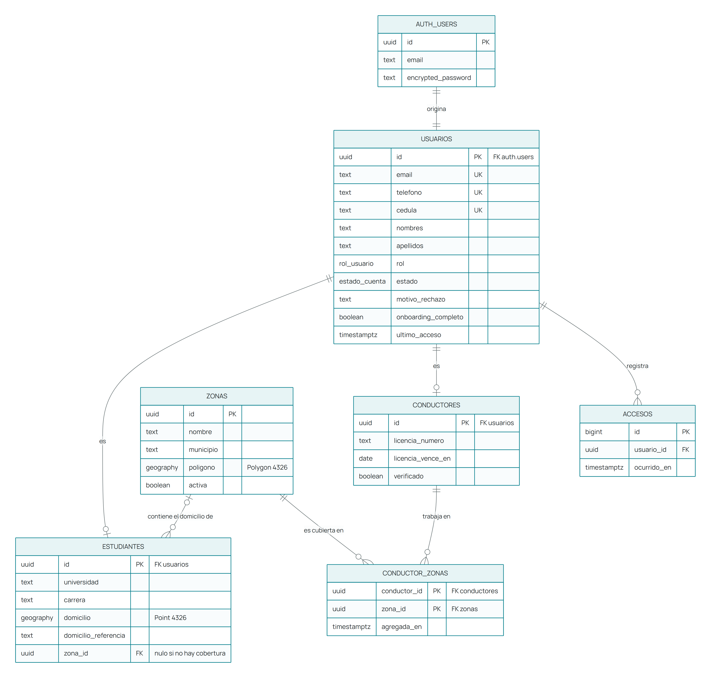

**Gráfico 33.** Diagrama entidad-relación de identidad y ubicación.
Fuente: Andrade, Espina y Ramírez (2026)

En el Gráfico 33 se observa que la tabla **usuarios** se relaciona uno a uno
con la cuenta de autenticación y se especializa en **estudiantes** o
**conductores** según el rol. La relación de muchos a muchos entre
conductores y zonas se resuelve con la tabla asociativa **conductor_zonas**,
cuya clave primaria compuesta impide registrar dos veces la misma zona. La
zona del estudiante admite valor nulo para representar los domicilios sin
cobertura.

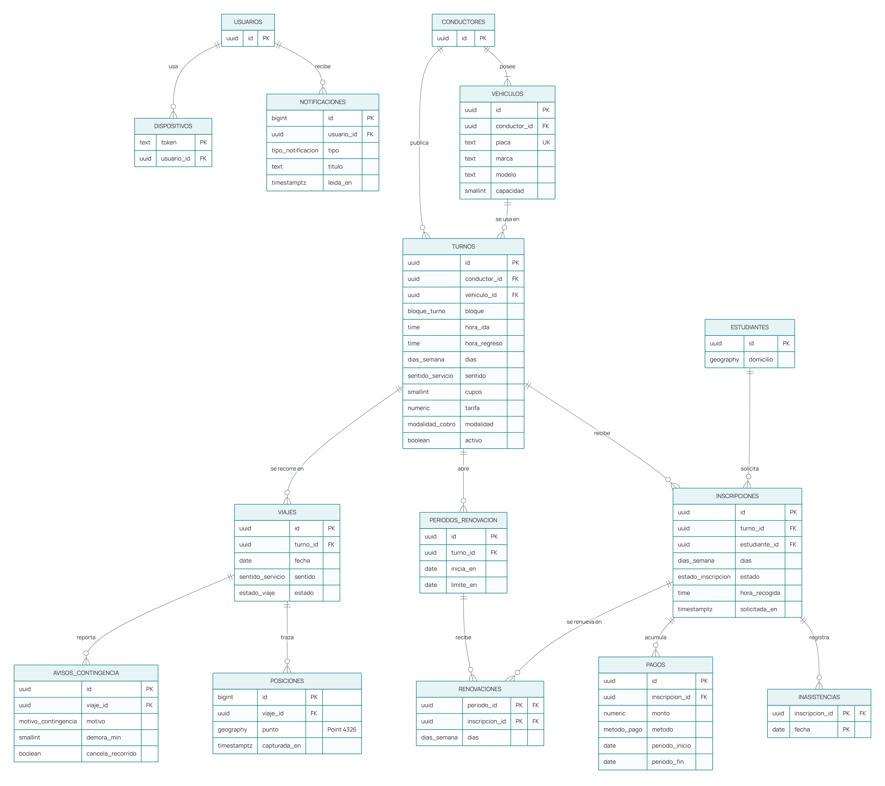

**Gráfico 34.** Diagrama entidad-relación de la operación del servicio.
Fuente: Andrade, Espina y Ramírez (2026)

El Gráfico 34 muestra las doce (12) entidades de la operación. Un conductor
posee vehículos y publica turnos; cada turno recibe inscripciones de
estudiantes, de las que dependen las inasistencias, los pagos y las
renovaciones de cada período. Cada turno se recorre en viajes, que registran
la traza de posiciones y los avisos de contingencia. Las notificaciones y los
dispositivos se asocian directamente al usuario, con independencia de su rol.

**Diseño físico**

La base de datos se implementa en PostgreSQL con la extensión PostGIS,
alojada en Supabase. Las decisiones de diseño físico más relevantes son las
siguientes:

1. **Datos geográficos.** Los domicilios, las zonas y las posiciones se
   almacenan con el tipo `geography` en el sistema de referencia WGS84
   (SRID 4326), que es el que entrega el GPS del teléfono, y se indexan con
   índices espaciales GiST.
2. **Tipos enumerados.** Los valores con un dominio cerrado (rol, estado de la
   cuenta, bloque, sentido, estado de la inscripción, método de pago, entre
   otros) se definen como tipos enumerados, de modo que el motor rechaza
   cualquier valor fuera de la lista (Cuadro 49).
3. **Reglas de negocio en el servidor.** Las operaciones que cambian el
   estado del servicio (solicitar y decidir un cupo, iniciar un viaje,
   registrar un pago) no se escriben directamente en las tablas, sino a
   través de funciones que validan las reglas antes de modificar los datos
   (Cuadro 68).
4. **Seguridad a nivel de fila.** Cada tabla tiene políticas que restringen
   qué filas puede leer o escribir cada usuario (Cuadro 69). Por ejemplo, la
   posición de un vehículo solo la ven el conductor y los estudiantes inscritos
   en ese turno.
5. **Registros sin borrado.** Los pagos no se eliminan: se anulan, lo que
   conserva el historial que exige la trazabilidad descrita en el Cuadro 13.

**Cuadro 49**
**Tipos enumerados de la base de datos**

| Tipo | Valores | Uso |
| --- | --- | --- |
| rol_usuario | estudiante, conductor, administrador | usuarios.rol |
| estado_cuenta | perfil_incompleto, pendiente, aprobada, rechazada, suspendida | usuarios.estado |
| bloque_turno | manana, tarde, noche | turnos.bloque |
| sentido_servicio | ida, regreso, ida_y_regreso | turnos.sentido, viajes.sentido |
| modalidad_cobro | semanal, quincenal, mensual | turnos.modalidad |
| estado_inscripcion | pendiente, aceptada, rechazada, cancelada, vencida | inscripciones.estado |
| estado_viaje | en_curso, finalizado, cancelado | viajes.estado |
| metodo_pago | dolares_efectivo, pago_movil, zelle, bolivares_efectivo | pagos.metodo |
| motivo_contingencia | averia, combustible, via_cerrada, otro | avisos_contingencia.motivo |
| tipo_notificacion | solicitud_nueva, solicitud_decidida, proximidad, contingencia, renovacion, cuenta | notificaciones.tipo |
| dias_semana (dominio) | Arreglo de 1 (lunes) a 7 (domingo), con al menos un día | turnos, inscripciones, renovaciones |

Fuente: Andrade, Espina y Ramírez (2026)

**Diccionario de datos**

En los Cuadros 50 a 67 se describe cada tabla. Abreviaturas: PK, clave
primaria; FK, clave foránea; UK, valor único; NN, no admite nulos.

**Cuadro 50**
**Diccionario de datos: usuarios**

| Campo | Tipo | Restricción | Descripción |
| --- | --- | --- | --- |
| id | uuid | PK, FK auth.users | Identificador de la cuenta de autenticación |
| email | text | NN, UK | Correo electrónico |
| telefono | text | UK | Teléfono móvil |
| nombres | text | NN | Nombres |
| apellidos | text | NN | Apellidos |
| cedula | text | UK | Cédula de identidad |
| rol | rol_usuario | NN | Estudiante, conductor o administrador |
| estado | estado_cuenta | NN | Estado de la cuenta (Gráfico 26) |
| url_foto | text | — | Fotografía de perfil |
| motivo_rechazo | text | — | Motivo indicado por el administrador al rechazar |
| onboarding_completo | boolean | NN | Si completó la configuración inicial de su rol |
| creado_en | timestamptz | NN | Fecha de registro |
| ultimo_acceso | timestamptz | — | Último inicio de sesión |

Fuente: Andrade, Espina y Ramírez (2026)

**Cuadro 51**
**Diccionario de datos: estudiantes**

| Campo | Tipo | Restricción | Descripción |
| --- | --- | --- | --- |
| id | uuid | PK, FK usuarios | Usuario estudiante |
| universidad | text | — | Universidad |
| carrera | text | — | Carrera |
| carnet | text | — | Número de carnet estudiantil |
| domicilio | geography(Point, 4326) | Índice GiST | Punto de recogida fijado en el mapa |
| domicilio_direccion | text | — | Dirección escrita |
| domicilio_referencia | text | — | Referencia para el conductor |
| zona_id | uuid | FK zonas | Zona detectada; nulo si no hay cobertura |
| domicilio_fijado_en | timestamptz | — | Momento en que se fijó el domicilio |

Fuente: Andrade, Espina y Ramírez (2026)

**Cuadro 52**
**Diccionario de datos: conductores**

| Campo | Tipo | Restricción | Descripción |
| --- | --- | --- | --- |
| id | uuid | PK, FK usuarios | Usuario conductor |
| licencia_numero | text | — | Número de licencia de conducir |
| licencia_vence_en | date | — | Vencimiento de la licencia |
| certificado_medico | text | — | Certificado médico |
| certificado_vence_en | date | — | Vencimiento del certificado médico |
| verificado | boolean | NN | Si el administrador verificó sus documentos |

Fuente: Andrade, Espina y Ramírez (2026)

**Cuadro 53**
**Diccionario de datos: zonas**

| Campo | Tipo | Restricción | Descripción |
| --- | --- | --- | --- |
| id | uuid | PK | Identificador |
| nombre | text | NN, UK con municipio | Nombre del sector |
| municipio | text | — | Municipio |
| poligono | geography(Polygon, 4326) | NN, índice GiST | Límite geográfico de la zona |
| activa | boolean | NN | Si se ofrece a conductores y estudiantes |
| creada_en | timestamptz | NN | Fecha de creación |

Fuente: Andrade, Espina y Ramírez (2026)

**Cuadro 54**
**Diccionario de datos: conductor_zonas**

| Campo | Tipo | Restricción | Descripción |
| --- | --- | --- | --- |
| conductor_id | uuid | PK, FK conductores | Conductor |
| zona_id | uuid | PK, FK zonas | Zona que cubre |
| agregada_en | timestamptz | NN | Fecha en que la agregó |

Fuente: Andrade, Espina y Ramírez (2026)

**Cuadro 55**
**Diccionario de datos: accesos**

| Campo | Tipo | Restricción | Descripción |
| --- | --- | --- | --- |
| id | bigint | PK | Identificador |
| usuario_id | uuid | NN, FK usuarios | Usuario que inició sesión |
| ocurrido_en | timestamptz | NN | Momento del inicio de sesión |
| user_agent | text | — | Cliente desde el que se conectó |

Fuente: Andrade, Espina y Ramírez (2026)

**Cuadro 56**
**Diccionario de datos: vehiculos**

| Campo | Tipo | Restricción | Descripción |
| --- | --- | --- | --- |
| id | uuid | PK | Identificador |
| conductor_id | uuid | NN, FK conductores | Propietario o conductor de la unidad |
| placa | text | NN, UK, 6 a 7 caracteres alfanuméricos | Placa |
| marca | text | NN | Marca |
| modelo | text | NN | Modelo |
| anio | smallint | Entre 1970 y 2100 | Año |
| color | text | NN | Color |
| capacidad | smallint | NN, mayor o igual a 1 | Asientos disponibles para pasajeros |
| url_foto | text | — | Fotografía de la unidad |
| creado_en | timestamptz | NN | Fecha de registro |

Fuente: Andrade, Espina y Ramírez (2026)

**Cuadro 57**
**Diccionario de datos: turnos**

| Campo | Tipo | Restricción | Descripción |
| --- | --- | --- | --- |
| id | uuid | PK | Identificador |
| conductor_id | uuid | NN, FK conductores | Conductor que lo ofrece |
| vehiculo_id | uuid | NN, FK vehiculos | Unidad con la que se presta; debe ser del mismo conductor |
| bloque | bloque_turno | NN | Mañana, tarde o noche |
| hora_ida | time | Obligatoria si hay ida | Hora de salida hacia la universidad |
| hora_regreso | time | Obligatoria si hay regreso; posterior a la ida | Hora de salida de regreso |
| dias | dias_semana | NN | Días de operación |
| sentido | sentido_servicio | NN | Ida, regreso o ambos |
| cupos | smallint | NN, de 1 a la capacidad del vehículo | Cupos ofertados |
| tarifa | numeric(10,2) | NN, mayor que 0 | Tarifa referencial en dólares |
| modalidad | modalidad_cobro | NN | Semanal, quincenal o mensual |
| activo | boolean | NN | Si se muestra en las búsquedas |
| creado_en | timestamptz | NN | Fecha de creación |

Fuente: Andrade, Espina y Ramírez (2026)

**Cuadro 58**
**Diccionario de datos: inscripciones**

| Campo | Tipo | Restricción | Descripción |
| --- | --- | --- | --- |
| id | uuid | PK | Identificador |
| turno_id | uuid | NN, FK turnos | Turno solicitado |
| estudiante_id | uuid | NN, FK estudiantes | Estudiante solicitante |
| dias | dias_semana | NN, contenidos en los días del turno | Días en que viaja |
| estado | estado_inscripcion | NN | Estado (Gráfico 27) |
| hora_recogida | time | — | Hora a la que el conductor acordó pasar por el domicilio; ordena la nómina |
| motivo_rechazo | text | — | Motivo indicado por el conductor |
| solicitada_en | timestamptz | NN | Fecha de la solicitud |
| decidida_en | timestamptz | — | Fecha de la decisión |

Una sola inscripción pendiente o aceptada por estudiante y turno (índice único parcial).

Fuente: Andrade, Espina y Ramírez (2026)

**Cuadro 59**
**Diccionario de datos: inasistencias**

| Campo | Tipo | Restricción | Descripción |
| --- | --- | --- | --- |
| inscripcion_id | uuid | PK, FK inscripciones | Inscripción del estudiante |
| fecha | date | PK | Día en que no viajará |
| avisada_en | timestamptz | NN | Momento del aviso |

Fuente: Andrade, Espina y Ramírez (2026)

**Cuadro 60**
**Diccionario de datos: periodos_renovacion**

| Campo | Tipo | Restricción | Descripción |
| --- | --- | --- | --- |
| id | uuid | PK | Identificador |
| turno_id | uuid | NN, FK turnos | Turno que se renueva |
| inicia_en | date | NN | Inicio del nuevo período académico |
| limite_en | date | NN, no posterior al inicio | Fecha límite para confirmar |
| cerrado | boolean | NN | Si ya se vencieron los cupos no renovados |
| creado_en | timestamptz | NN | Fecha de apertura |

Fuente: Andrade, Espina y Ramírez (2026)

**Cuadro 61**
**Diccionario de datos: renovaciones**

| Campo | Tipo | Restricción | Descripción |
| --- | --- | --- | --- |
| periodo_id | uuid | PK, FK periodos_renovacion | Período |
| inscripcion_id | uuid | PK, FK inscripciones | Inscripción renovada |
| dias | dias_semana | NN | Días de asistencia del nuevo período |
| confirmada_en | timestamptz | NN | Momento de la confirmación |

Fuente: Andrade, Espina y Ramírez (2026)

**Cuadro 62**
**Diccionario de datos: viajes**

| Campo | Tipo | Restricción | Descripción |
| --- | --- | --- | --- |
| id | uuid | PK | Identificador |
| turno_id | uuid | NN, FK turnos | Turno recorrido |
| fecha | date | NN, hora de Venezuela | Día del viaje |
| sentido | sentido_servicio | NN, ida o regreso | Sentido del recorrido |
| estado | estado_viaje | NN | En curso, finalizado o cancelado |
| iniciado_en | timestamptz | NN | Inicio del recorrido |
| finalizado_en | timestamptz | — | Fin del recorrido |

Un solo viaje por turno, fecha y sentido (restricción única).

Fuente: Andrade, Espina y Ramírez (2026)

**Cuadro 63**
**Diccionario de datos: posiciones**

| Campo | Tipo | Restricción | Descripción |
| --- | --- | --- | --- |
| id | bigint | PK | Identificador secuencial |
| viaje_id | uuid | NN, FK viajes | Viaje al que pertenece |
| punto | geography(Point, 4326) | NN | Posición del vehículo |
| precision_m | real | — | Precisión reportada por el GPS, en metros |
| capturada_en | timestamptz | NN | Hora de captura en el teléfono |
| recibida_en | timestamptz | NN | Hora de llegada al servidor |

Fuente: Andrade, Espina y Ramírez (2026)

**Cuadro 64**
**Diccionario de datos: avisos_contingencia**

| Campo | Tipo | Restricción | Descripción |
| --- | --- | --- | --- |
| id | uuid | PK | Identificador |
| viaje_id | uuid | NN, FK viajes | Viaje afectado |
| motivo | motivo_contingencia | NN | Avería, combustible, vía cerrada u otro |
| detalle | text | Obligatorio si el motivo es «otro» | Descripción |
| demora_min | smallint | Mayor que 0; obligatorio si no se cancela | Demora estimada en minutos |
| cancela_recorrido | boolean | NN | Si el recorrido se cancela |
| enviado_en | timestamptz | NN | Momento del envío |

Fuente: Andrade, Espina y Ramírez (2026)

**Cuadro 65**
**Diccionario de datos: pagos**

| Campo | Tipo | Restricción | Descripción |
| --- | --- | --- | --- |
| id | uuid | PK | Identificador |
| inscripcion_id | uuid | NN, FK inscripciones | Inscripción a la que corresponde |
| monto | numeric(10,2) | NN, mayor que 0 | Monto pagado |
| metodo | metodo_pago | NN | Método de pago |
| periodo_inicio | date | NN | Inicio del período cubierto |
| periodo_fin | date | NN, no anterior al inicio | Fin del período cubierto |
| registrado_en | timestamptz | NN | Momento del registro |
| anulado_en | timestamptz | — | Momento de la anulación, si la hubo |

Un solo pago vigente por inscripción y período (índice único parcial).

Fuente: Andrade, Espina y Ramírez (2026)

**Cuadro 66**
**Diccionario de datos: notificaciones**

| Campo | Tipo | Restricción | Descripción |
| --- | --- | --- | --- |
| id | bigint | PK | Identificador secuencial |
| usuario_id | uuid | NN, FK usuarios | Destinatario |
| tipo | tipo_notificacion | NN | Tipo de aviso |
| titulo | text | NN | Título |
| cuerpo | text | NN | Mensaje |
| viaje_id | uuid | FK viajes | Viaje relacionado, si aplica |
| inscripcion_id | uuid | FK inscripciones | Inscripción relacionada, si aplica |
| creada_en | timestamptz | NN | Momento de creación |
| leida_en | timestamptz | — | Momento de lectura |

Un solo aviso de proximidad por estudiante y viaje (índice único parcial).

Fuente: Andrade, Espina y Ramírez (2026)

**Cuadro 67**
**Diccionario de datos: dispositivos**

| Campo | Tipo | Restricción | Descripción |
| --- | --- | --- | --- |
| token | text | PK | Token de notificaciones del teléfono |
| usuario_id | uuid | NN, FK usuarios | Dueño del dispositivo |
| plataforma | text | NN | Plataforma (android) |
| actualizado_en | timestamptz | NN | Última actualización del token |

Fuente: Andrade, Espina y Ramírez (2026)

**Cuadro 68**
**Funciones de negocio del servidor**

| Función | Historia | Qué valida o hace |
| --- | --- | --- |
| detectar_zona (disparador) | HU-003 | Asigna al domicilio la zona activa de menor área que lo contiene |
| validar_turno (disparador) | HU-006 | El vehículo es del conductor y los cupos no superan su capacidad |
| buscar_turnos | HU-007 | Turnos activos de conductores aprobados que cubren la zona del estudiante, con cupo libre |
| solicitar_cupo | HU-008 | Domicilio fijado, días válidos, una solicitud por bloque y cupo disponible; notifica al conductor |
| detalle_solicitud | HU-009 | Entrega al conductor del turno el domicilio, la foto, la cédula y el teléfono del solicitante, sin abrirle la tabla de estudiantes |
| decidir_solicitud | HU-009 | Solo el conductor del turno decide; bloquea el turno para no exceder los cupos; notifica al estudiante |
| fijar_hora_recogida | HU-010 | Solo el conductor del turno fija la hora acordada para cada inscrito |
| marcar_inasistencia | HU-010 | Solo antes de que el viaje de ese día finalice |
| nomina_del_dia | HU-010 | Inscritos aceptados que viajan esa fecha, descontando inasistencias |
| iniciar_viaje / finalizar_viaje | HU-011 | Un viaje por turno, fecha y sentido; solo el conductor del turno |
| avisar_proximidad (disparador) | HU-014 | Con cada posición, notifica a los domicilios de la nómina dentro del radio, una vez por viaje |
| enviar_contingencia | HU-015 | Motivo obligatorio; notifica a toda la nómina y, si cancela, cierra el viaje |
| registrar_pago / anular_pago | HU-013 | Monto positivo y un pago vigente por período |
| abrir_renovacion / renovar_cupo | HU-016 | Plazo vigente y renovación solo del propio cupo |
| vencer_renovaciones (tarea programada) | HU-016 | Al pasar la fecha límite, vence las inscripciones no renovadas y libera los cupos |

Fuente: Andrade, Espina y Ramírez (2026)

**Cuadro 69**
**Políticas de seguridad a nivel de fila**

| Tabla | Quién lee | Quién escribe |
| --- | --- | --- |
| usuarios, estudiantes, conductores | El propio usuario y el administrador | El propio usuario, salvo rol y estado (solo mediante funciones) |
| zonas | Cualquier usuario autenticado | Solo el administrador |
| conductor_zonas | El conductor y el administrador | El conductor |
| vehiculos, turnos | Cualquier usuario autenticado (turnos activos) | Su conductor |
| inscripciones, inasistencias, renovaciones, pagos | El estudiante y el conductor del turno | Solo mediante funciones |
| viajes, avisos_contingencia | El conductor y los inscritos del turno | Solo mediante funciones |
| posiciones | El conductor y los inscritos del turno | El conductor, solo en su viaje en curso |
| notificaciones | Su destinatario | El sistema; el destinatario solo marca la lectura |
| dispositivos | Su dueño | Su dueño |

Fuente: Andrade, Espina y Ramírez (2026)

El diseño físico de la operación se validó ejecutando el script completo
sobre la base de datos de desarrollo dentro de una transacción que luego se
revirtió, sin dejar cambios. En esa ejecución se comprobó que el sistema
rechaza un turno con más cupos que la capacidad del vehículo, impide una
segunda solicitud del mismo estudiante en el mismo bloque horario, impide que
un estudiante decida sobre su propia solicitud, deja el turno sin cupos
libres tras aceptar la única plaza ofertada, incluye al estudiante en la
nómina del lunes y genera un solo aviso de proximidad aunque la unidad
transmita dos posiciones junto a su domicilio.

---

**1.1.2.4. CONSTRUCCIÓN DE PROTOTIPOS DE INTERFAZ DE USUARIO**

En cumplimiento de la cuarta actividad de la Fase II, se construyeron los
prototipos de interfaz de usuario de la aplicación móvil, con énfasis en las
pantallas que operan sobre mapas y paradas. Cada prototipo responde a una o más
historias de usuario del catálogo y a los requerimientos funcionales del
Cuadro 16, de modo que la interfaz materializa las necesidades expresadas por
los transportistas y los estudiantes. Los prototipos se elaboraron en alta
fidelidad, aplicando el sistema de diseño definido para la aplicación: el verde
lago como color de acento, la tipografía Teko para títulos y botones, Manrope
para el resto del texto, la iconografía Lucide y una jerarquía visual basada en
bordes y fondos en lugar de sombras. Los estados se expresan con una
convención cromática constante: verde para lo confirmado, ámbar para lo
pendiente o próximo a vencer y rojo para lo cancelado. Los mapas son
representaciones esquemáticas de la ciudad de Maracaibo, que muestran la
lógica de zonas, domicilios, paradas y unidades sin reproducir la cartografía
real, y los nombres, documentos y montos que aparecen son datos ficticios. Los
Gráficos 35 a 47 presentan las pantallas del estudiante, del conductor y del
administrador.

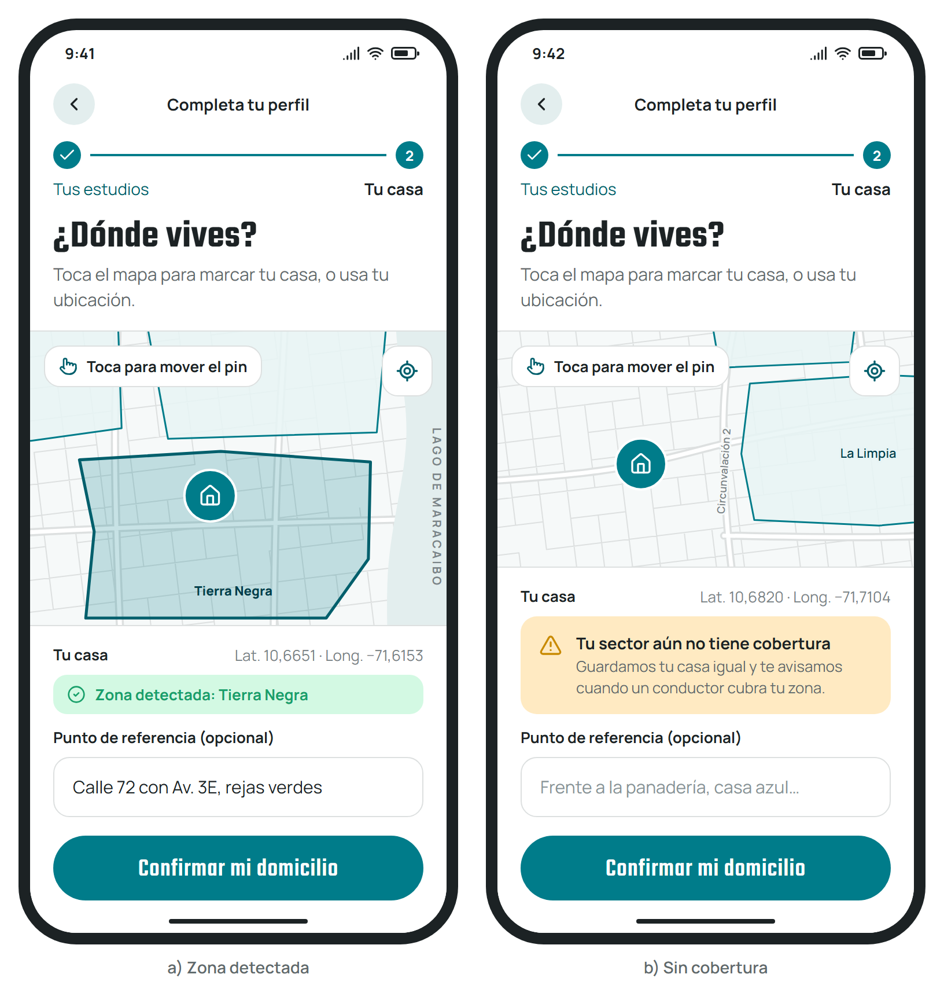

**Gráfico 35.** Prototipo de la fijación del domicilio en el mapa: a) zona detectada; b) sector sin cobertura.
Fuente: Andrade, Espina y Ramírez (2026)

El Gráfico 35 muestra el paso en que el estudiante marca su domicilio sobre el
mapa, en atención a la historia de usuario HU-003. Al ubicar el marcador, el
sistema resalta el polígono de la zona que lo contiene y confirma la zona
detectada, junto con las coordenadas del punto y un campo opcional para un
punto de referencia (a). Cuando el domicilio cae fuera de las zonas activas, la
interfaz advierte que el sector aún no tiene cobertura, pero permite guardar la
ubicación para notificar al estudiante cuando un conductor la atienda (b). De
esta forma, el estudiante no necesita conocer la división del servicio: le
basta con señalar su vivienda.

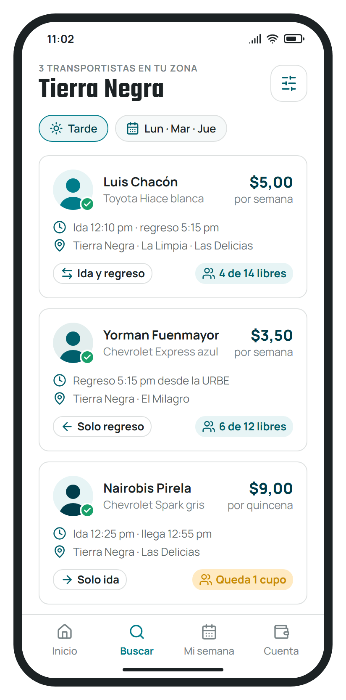

**Gráfico 36.** Prototipo de los resultados de búsqueda de transportistas por zona.
Fuente: Andrade, Espina y Ramírez (2026)

El Gráfico 36 presenta los transportistas que cubren la zona del estudiante,
según la historia de usuario HU-007. Cada tarjeta reúne los datos que los
estudiantes señalaron como determinantes para elegir un servicio (Tablas 7 y
8): la foto del conductor con su marca de verificación, el vehículo, el
horario de ida o regreso, el sentido del servicio, las zonas cubiertas, la
tarifa con su modalidad de cobro y los cupos libres. El contador de cupos
cambia a color ámbar cuando queda un solo puesto, lo que anticipa la
disponibilidad sin que el estudiante tenga que consultar al conductor.

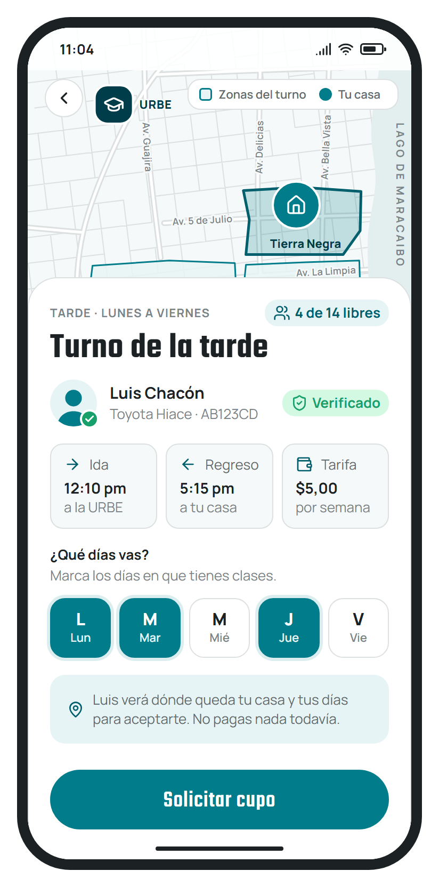

**Gráfico 37.** Prototipo del detalle del turno y la solicitud de cupo.
Fuente: Andrade, Espina y Ramírez (2026)

El Gráfico 37 corresponde a la historia de usuario HU-008. En la parte
superior, el mapa sitúa las zonas que atiende el turno, el domicilio del
estudiante y la URBE; debajo, se resumen el conductor verificado, las horas de
ida y de regreso, la tarifa y los puestos disponibles. El estudiante marca los
días de la semana en que asiste a clases y envía la solicitud con el botón
«Solicitar cupo». Un aviso le indica que el conductor verá la ubicación de su
casa y los días elegidos para decidir, y que no realiza ningún pago en ese
momento.

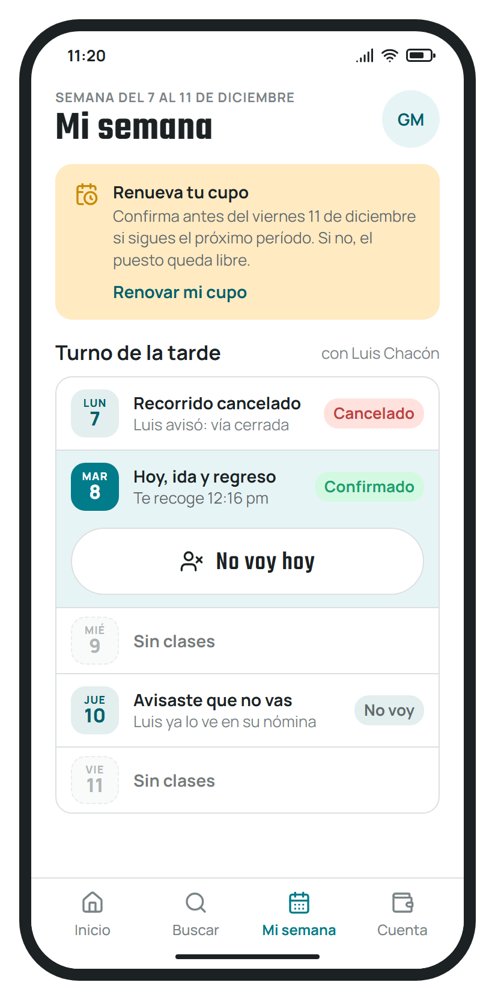

**Gráfico 38.** Prototipo de la vista semanal del estudiante, con aviso de inasistencia y renovación del cupo.
Fuente: Andrade, Espina y Ramírez (2026)

El Gráfico 38 reúne dos historias de usuario del estudiante inscrito. Por un
lado, atiende la HU-010: cada día de la semana muestra el estado de la
inscripción (cancelado por el conductor, confirmado, sin clases o con
inasistencia notificada) y la hora de recogida acordada, y el día en curso
ofrece el botón «No voy hoy», que retira al estudiante de la nómina del
conductor antes de la salida. Por otro lado, responde a la HU-016 mediante un
aviso de renovación que indica la fecha límite para conservar el cupo en el
período siguiente y advierte que, vencido el plazo, el puesto queda libre.

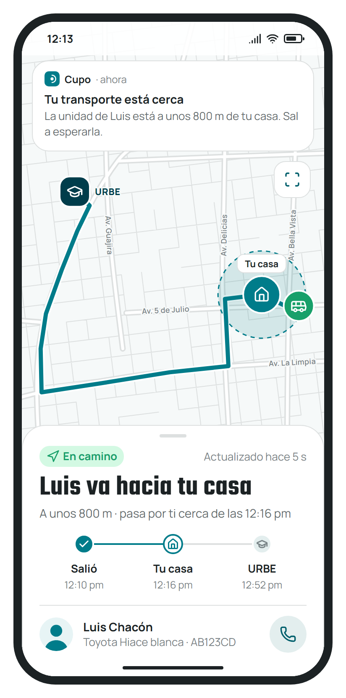

**Gráfico 39.** Prototipo del seguimiento del viaje en vivo y del aviso de proximidad.
Fuente: Andrade, Espina y Ramírez (2026)

El Gráfico 39 ilustra las historias de usuario HU-011 y HU-014. El mapa muestra
la posición de la unidad, el domicilio del estudiante con su radio de
proximidad y la URBE como destino, unidos por el trazado del recorrido. Cuando
la unidad entra en ese radio, el estudiante recibe la notificación «Tu
transporte está cerca», aun con la aplicación cerrada. La hoja inferior
resume el avance del viaje en tres hitos (salida, recogida y llegada); la hora
de recogida es la acordada con el conductor y no un cálculo sobre la red vial,
que queda fuera del alcance (Cuadro 18). La pantalla indica además cuándo se
actualizó la posición y permite llamar al conductor. Por resguardo de la
privacidad, el estudiante no ve los domicilios de los demás pasajeros.

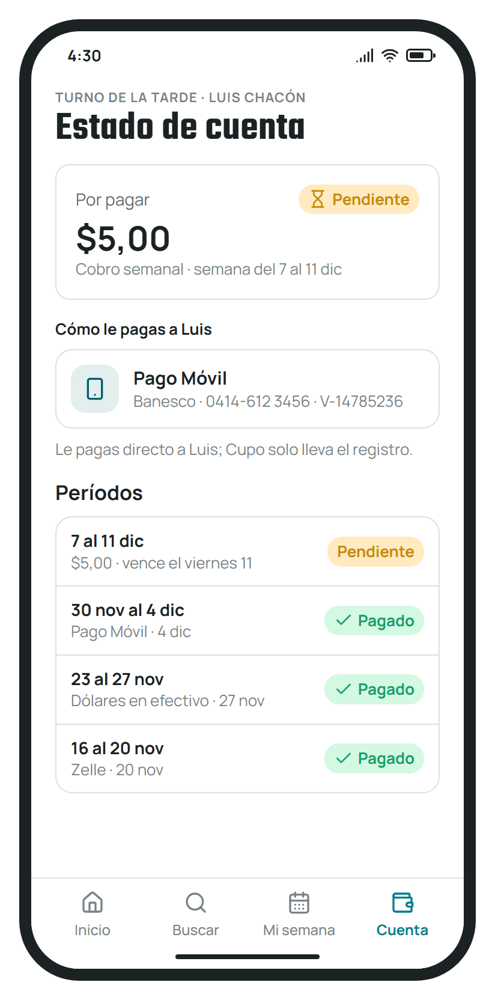

**Gráfico 40.** Prototipo del estado de cuenta del estudiante.
Fuente: Andrade, Espina y Ramírez (2026)

El Gráfico 40 muestra la consulta que la historia de usuario HU-013 prevé para
el estudiante. Se destaca el monto por pagar del período en curso, en estado
pendiente, seguido del método de pago que acepta el conductor y del historial
de períodos, cada uno con su estado y el medio con que se pagó: Pago Móvil,
dólares en efectivo o Zelle. La pantalla aclara que el pago se entrega
directamente al conductor y que la aplicación solo deja constancia de él, sin
procesar transacciones.

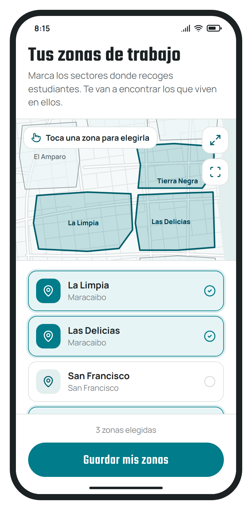

**Gráfico 41.** Prototipo de la selección de zonas de trabajo del conductor.
Fuente: Andrade, Espina y Ramírez (2026)

El Gráfico 41 corresponde a la historia de usuario HU-005. El conductor elige
los sectores donde recoge estudiantes de dos maneras sincronizadas: tocando los
polígonos en el mapa o marcándolos en la lista de selección múltiple. Las
zonas elegidas se resaltan en ambos lugares, y el pie de la pantalla indica
cuántas van seleccionadas antes de guardar. Con esta selección, el sistema
vincula al conductor con los estudiantes que viven en esas zonas.

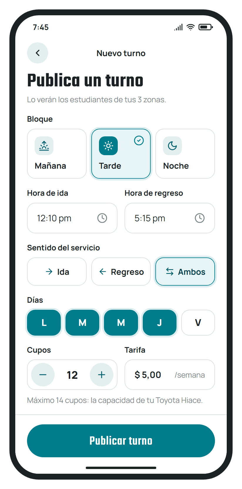

**Gráfico 42.** Prototipo de la creación y publicación de un turno.
Fuente: Andrade, Espina y Ramírez (2026)

El Gráfico 42 presenta el formulario de la historia de usuario HU-006. El
conductor define el bloque horario (mañana, tarde o noche), las horas de ida y
de regreso, el sentido del servicio (ida, regreso o ambos), los días de
operación, la cantidad de cupos y la tarifa con su modalidad de cobro. El
selector de cupos indica la capacidad del vehículo registrado e impide
ofrecer más puestos que los disponibles, conforme a la validación de la
historia.

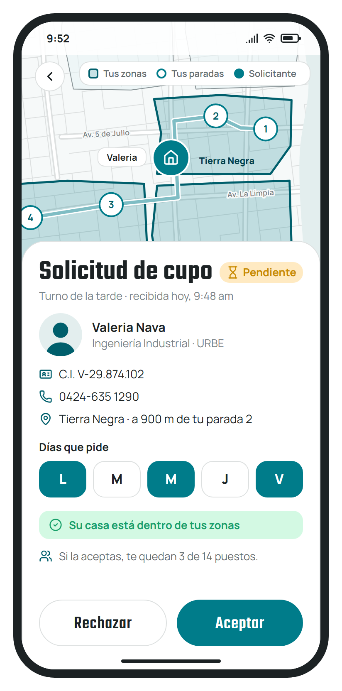

**Gráfico 43.** Prototipo de la evaluación de una solicitud de cupo por el conductor.
Fuente: Andrade, Espina y Ramírez (2026)

El Gráfico 43 atiende la historia de usuario HU-009. El mapa ubica el
domicilio de la solicitante respecto a las zonas del conductor y a las paradas
de su recorrido, lo que le permite valorar el desvío antes de comprometer un
puesto, tal como lo plantearon los transportistas en los Cuadros 8 y 9.
Debajo, se muestra el perfil de la estudiante (foto, cédula y teléfono), los
días que solicita, la confirmación de que su casa está dentro de las zonas del
conductor y los cupos que quedarían libres, con los botones «Aceptar» y
«Rechazar».

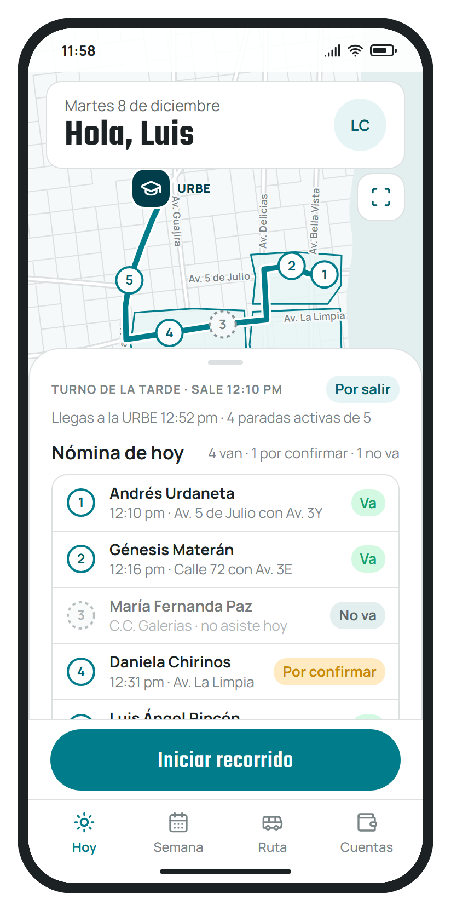

**Gráfico 44.** Prototipo de la pantalla «Hoy» del conductor, con la nómina y el orden de paradas.
Fuente: Andrade, Espina y Ramírez (2026)

El Gráfico 44 integra las historias de usuario HU-010 y HU-011 en la vista
operativa del conductor. El mapa traza el recorrido del turno con las paradas
numeradas en orden de recogida; la parada del pasajero que notificó su
inasistencia aparece inactiva. La hoja inferior presenta la nómina del día,
ordenada por la hora de recogida acordada, con el estado de cada pasajero (va,
por confirmar o no va), y el botón «Iniciar recorrido», que activa la
transmisión de la ubicación de la unidad hacia los estudiantes del turno.

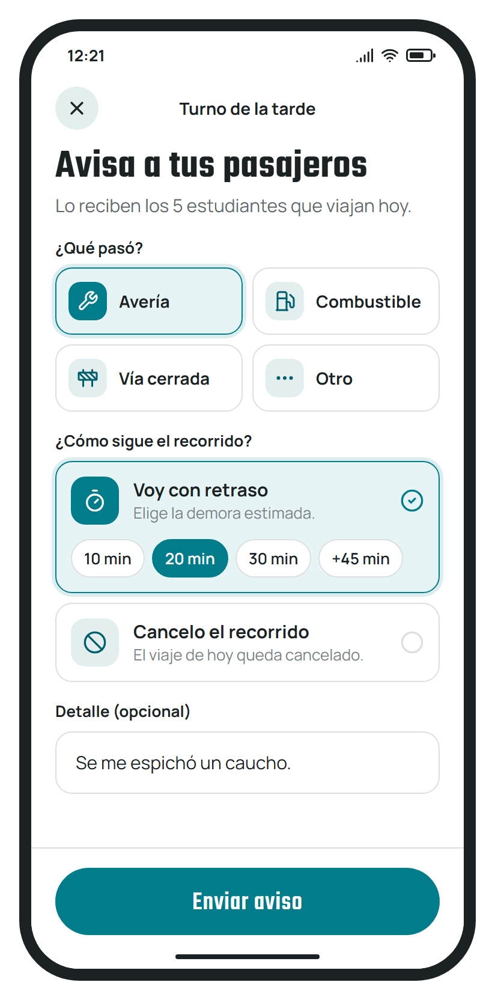

**Gráfico 45.** Prototipo del aviso de contingencia a los pasajeros del turno.
Fuente: Andrade, Espina y Ramírez (2026)

El Gráfico 45 corresponde a la historia de usuario HU-015. En un solo paso, el
conductor elige el motivo de la contingencia (avería, combustible, vía cerrada
u otro), indica si continuará con una demora estimada o si cancela el
recorrido del día, y agrega un detalle opcional. El aviso llega a todos los
estudiantes que viajan ese día, sin que el conductor deba contactarlos uno por
uno.

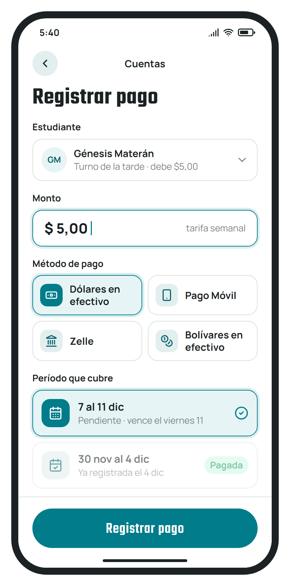

**Gráfico 46.** Prototipo del registro de pagos por el conductor.
Fuente: Andrade, Espina y Ramírez (2026)

El Gráfico 46 muestra la contraparte del conductor en la historia de usuario
HU-013. El conductor selecciona al estudiante, indica el monto, el método de
pago (dólares en efectivo, Pago Móvil, Zelle o bolívares en efectivo) y el
período que cubre. Los períodos ya pagados aparecen deshabilitados, lo que
evita registrar dos veces el mismo pago, y el registro actualiza el estado de
cuenta que consulta el estudiante.

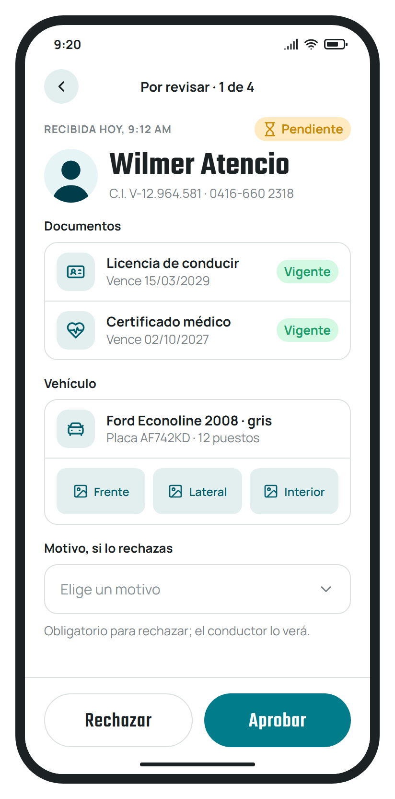

**Gráfico 47.** Prototipo de la revisión del expediente de un conductor por el administrador.
Fuente: Andrade, Espina y Ramírez (2026)

El Gráfico 47 corresponde a la historia de usuario HU-012. El administrador
revisa el expediente de un conductor en estado pendiente: sus datos de
identificación, la vigencia de la licencia de conducir y del certificado
médico, y los datos y fotografías del vehículo. Desde la misma pantalla puede
aprobar la cuenta o rechazarla; en este último caso, el motivo es
obligatorio, para que el conductor sepa qué recaudo debe subsanar.

---

**1.1.2.5. DEFINICIÓN DE LA METÁFORA DEL SISTEMA Y GLOSARIO DE TÉRMINOS TÉCNICOS**

En la Programación Extrema, la metáfora del sistema es una imagen compartida
que permite a los usuarios y a los programadores hablar del sistema con las
mismas palabras. Para Cupo se adoptó la metáfora de **la libreta y la corneta
del transportista**. Hoy, el chofer lleva en una libreta quiénes tienen
puesto en su unidad, qué días viajan y quién le ha pagado (Cuadro 13), y
anuncia su llegada tocando la corneta frente a cada casa, ya que el 88,2 % de
los estudiantes es recogido en la puerta de su domicilio (Tabla 10). Cupo es
esa libreta, compartida y siempre actualizada, y esa corneta, que suena en el
teléfono del estudiante antes de que la unidad llegue. El Cuadro 70 relaciona
cada elemento de la metáfora con su concepto en el sistema.

**Cuadro 70**
**Metáfora del sistema**

| En la práctica actual | En Cupo | Historia |
| --- | --- | --- |
| La ruta habitual del chofer, «por donde paso» | Zonas de cobertura | HU-005 |
| La salida de la mañana, la tarde o la noche | Turno | HU-006 |
| Preguntar en grupos y a conocidos quién tiene puesto | Búsqueda por zona y turno | HU-007 |
| El puesto apartado en la unidad | Cupo (inscripción aceptada) | HU-008, HU-009 |
| La lista de la libreta | Nómina del día | HU-010 |
| «Mañana no voy», por WhatsApp | Aviso de inasistencia | HU-010 |
| Mirar por la ventana a ver si ya viene | Seguimiento en vivo | HU-011 |
| La corneta frente a la casa | Aviso de proximidad | HU-014 |
| «Se me accidentó el carro», al grupo | Aviso de contingencia | HU-015 |
| Anotar el pago en la libreta | Registro de pago | HU-013 |
| Apartar el puesto para el próximo semestre | Renovación del cupo | HU-016 |

Fuente: Andrade, Espina y Ramírez (2026)

Para completar el vocabulario común, el Cuadro 71 define los términos
técnicos y de negocio empleados en el diseño.

**Cuadro 71**
**Glosario de términos**

| Término | Definición |
| --- | --- |
| Aviso de contingencia | Mensaje que el conductor envía a todos los pasajeros de un turno ante una avería, falta de combustible o cierre de vías, con la demora estimada o la cancelación del viaje. |
| Aviso de proximidad | Notificación que recibe el estudiante cuando la unidad entra en un radio configurable alrededor de su domicilio. |
| Bloque | Franja horaria de un turno: mañana, tarde o noche. |
| Cupo | Puesto que un estudiante ocupa en un turno; equivale a una inscripción aceptada. |
| Disparador (trigger) | Función de la base de datos que se ejecuta automáticamente al insertar o modificar una fila. |
| Domicilio | Punto geográfico de la casa del estudiante, fijado en el mapa, que sirve como punto de recogida. |
| Estado de la cuenta | Situación de un usuario en el proceso de verificación: perfil incompleto, pendiente, aprobada, rechazada o suspendida. No debe confundirse con el estado de cuenta de pagos. |
| Estado de cuenta (pagos) | Relación de los períodos pagados y pendientes de un estudiante con su conductor. |
| Firebase Cloud Messaging | Servicio de Google que entrega notificaciones push a teléfonos Android. |
| Flutter | Marco de desarrollo de Google para construir aplicaciones móviles a partir de un único código fuente en el lenguaje Dart. |
| Hora de recogida | Hora a la que el conductor acuerda pasar por el domicilio de cada inscrito. No es un cálculo de llegada: es el acuerdo que hoy se hace de palabra, y ordena la nómina. |
| Inscripción | Vínculo entre un estudiante y un turno, con los días en que viaja y su estado. |
| Nómina del día | Lista de estudiantes que viajan en un turno en una fecha, descontadas las inasistencias. |
| Notificación push | Mensaje que el sistema envía al teléfono aunque la aplicación esté cerrada. |
| Parada | Punto del recorrido donde el conductor recoge a un pasajero. Como el servicio es puerta a puerta, coincide con su domicilio. |
| Período de renovación | Plazo que abre el conductor para que sus inscritos confirmen su continuidad en el siguiente período académico. |
| Polígono | Figura geográfica cerrada que delimita una zona. |
| PostGIS | Extensión de PostgreSQL que agrega tipos y funciones para almacenar y analizar datos geográficos. |
| Punto en polígono | Operación espacial que determina si un punto está contenido en un polígono; se usa para asignar la zona del domicilio. |
| Realtime | Servicio de Supabase que envía a los clientes conectados los cambios de la base de datos en el momento en que ocurren. |
| Seguridad a nivel de fila (RLS) | Mecanismo de PostgreSQL que limita qué filas de una tabla puede leer o modificar cada usuario. |
| Servicio en primer plano | Proceso de Android que mantiene la captura de ubicación activa con la aplicación minimizada, acompañado de una notificación visible. |
| SIG | Sistema de Información Geográfico: sistema que captura, almacena, analiza y presenta datos referenciados a una ubicación. |
| Supabase | Plataforma en la nube que ofrece base de datos PostgreSQL, autenticación, tiempo real, almacenamiento y funciones. |
| Turno | Oferta de un conductor en un bloque horario, con vehículo, días, sentido, cupos y tarifa. |
| Viaje | Recorrido de un turno en una fecha y un sentido. |
| WGS84 (SRID 4326) | Sistema de referencia geográfico de latitud y longitud que usa el GPS. |
| Zona | Sector geográfico de la ciudad, definido por un polígono, que cubren los conductores y en el que reside el estudiante. |

Fuente: Andrade, Espina y Ramírez (2026)

Con la definición de la metáfora y el glosario concluye la Fase II. Sus
artefactos constituyen la referencia para la fase de codificación, en la que
cada historia de usuario se implementará sobre el modelo de datos validado y
siguiendo las pautas de trabajo descritas en el apartado 1.1.1.6.
